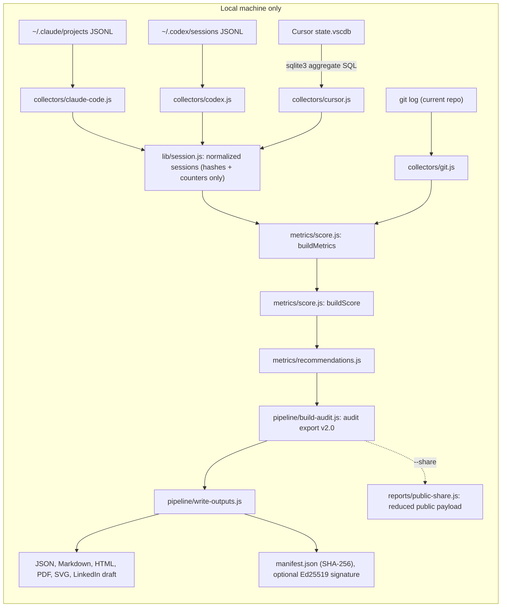

# Architecture

`wonka-audit` is a single-process Node.js CLI (ES modules, Node 18+, zero runtime dependencies). It reads AI-tool logs that already exist on the machine, reduces them to counts and hashes in memory, scores practice quality, and writes a report bundle to a local folder. It makes no network calls.

## Pipeline

| Layer | Modules | Responsibility |
| --- | --- | --- |
| Entry | `src/cli.js`, `src/lib/args.js` | Parse flags, pick a mode (audit, `--preview`, `--compare`, `--aggregate`, `--share <file>`, `--verify-signature`), print the privacy notice. |
| Collect | `src/collectors/*.js`, `src/lib/collection.js` | Parse one tool's local format. Each runs in `collectSafely()`, so one broken source marks itself `error` and the others still report. |
| Normalize | `src/lib/session.js`, `src/lib/classify.js` | One session shape for all tools. Prompt text is classified in memory into five booleans (vague, contextualized, constrained, correction, categories) and dropped. |
| Score | `src/metrics/score.js`, `src/metrics/recommendations.js` | Rates per dimension, weighted score, confidence, priority levers. |
| Assemble | `src/pipeline/build-audit.js`, `src/lib/contracts.js` | Pure function: collector results to the audit export with version and comparability metadata. No I/O. |
| Render and write | `src/reports/*.js`, `src/pipeline/write-outputs.js` | Pure renderers (string in, string out) plus one module that owns every filesystem write. |
| Fleet | `src/enterprise/aggregate.js`, `src/reports/compare.js`, `src/lib/schema.js`, `src/lib/signature.js` | Validate, compare and aggregate exports that users chose to hand over. |

Collectors run concurrently (`Promise.all`); JSONL is streamed line by line, so memory is bounded by the number of sessions, not log size.

## Privacy model

The design rule: **raw content never leaves the collector's stack frame.** Each guarantee below is enforced in code, not only in documentation.

| Guarantee | Where it is enforced |
| --- | --- |
| No network I/O | No module imports `http`, `https`, `net` or `fetch`. The only subprocesses are `git` and `sqlite3` via `execFileSync` with fixed argument arrays (`collectors/git.js`, `collectors/cursor.js`). `--upload` throws. |
| Prompt and answer text is never stored | `lib/session.js#applyPromptFeatures` keeps only counters and category names. Sessions have no text field. With `--no-content` / `--metadata-only`, collectors skip classification, and the Cursor SQL selects `''` instead of the message text. |
| Paths are never stored | `registerPath()` keeps the file extension only. Working directories are reduced to `cwd_hash` and `project_label_hash`. Manifest entries use `basename()`. |
| Identifiers cannot be linked across runs | `lib/privacy.js#makePrivacy` salts SHA-256 with 32 random bytes per run. The salt is never written. |
| Cross-run identity only when an operator asks for it | `stableParticipantHash()` needs both `WONKA_AUDIT_PARTICIPANT_ID` and a 24+ character `WONKA_AUDIT_TENANT_SECRET`; output is an HMAC. |
| Collector errors do not leak paths | `lib/collection.js#collectSafely` exports only the error class name. |
| Cursor is read through aggregates | `collectors/cursor.js` uses `json_extract` / `json_array_length` in SQL. Bubble text is cut to 1,200 characters inside SQLite and only when classification is on. |
| Public share is a strict subset | `reports/public-share.js#buildPublicSharePayload` builds a new object from an allow-list: no org, team, participant hash, hashes or collector details. |
| Small cohorts are suppressed | `enterprise/aggregate.js` refuses `--min-cohort-size` below 3 and drops cohorts under the threshold. Mixed methodologies are rejected. |

The export records its own guarantees under `privacy` (`content_uploaded: false`, `raw_content_exported: false`, `local_content_inspection`). CI asserts these on every OS and Node version.

The threat model is in [THREAT-MODEL.md](./THREAT-MODEL.md). The security brief is in [SECURITY-CISO.md](../SECURITY-CISO.md).

## Scoring model

`buildMetrics()` turns sessions into rates in five groups: adoption, business usage, interaction quality, verifiable impact, fair usage. `buildScore()` scores each component on a piecewise-linear 0–100 scale between expert thresholds (poor / healthy / strong) and combines five dimensions:

| Dimension | Weight |
| --- | --- |
| Usage consistency | 20% |
| Real work usage | 25% |
| Interaction quality | 20% |
| Proof and impact | 25% |
| Fair usage | 10% |

A signal the source cannot observe (for example validation in Cursor) is `null`. It is removed from its dimension and the remaining weights are rebalanced, so it is never scored as zero. Token volume is not a scored input. The score is labeled `directional_uncalibrated`, and confidence depends on sample size and source coverage.

Versions (`AUDIT_SCHEMA_VERSION`, `METHODOLOGY_VERSION`, `SCORING_MODEL_VERSION`) live in `src/lib/contracts.js`. They are combined into a `comparability_key`, and `--compare` and `--aggregate` refuse to mix exports with different keys.

Thresholds, limitations and calibration plan: [METHODOLOGY.md](../METHODOLOGY.md), [KPI-SPEC.md](./KPI-SPEC.md), [CALIBRATION-PLAN.md](./CALIBRATION-PLAN.md).

## Outputs

One run writes one folder: `--out <dir>`, or by default `Desktop/Wonka AI Audit/<label>_<start>_to_<end>_<timestamp>/`. Runs never overwrite each other.

| File | Producer | Contract |
| --- | --- | --- |
| `wonka-ai-audit-report.json` | `pipeline/build-audit.js` | [`schemas/audit-export.schema.json`](../schemas/audit-export.schema.json) |
| `index.html` | `reports/html.js` | Self-contained page, inline CSS/JS |
| `wonka-ai-usage-audit.pdf` | `reports/pdf.js` | PDF 1.4 written by hand, no dependency |
| `wonka-ai-audit-report.md` | `reports/markdown.js` | |
| `wonka-ai-wrapped-card.svg` | `reports/card-svg.js` | |
| `linkedin-post.txt` | `reports/linkedin.js` | |
| `wonka-ai-audit-methodology.json` | `pipeline/write-outputs.js` | Versions, coverage and privacy flags only |
| `wonka-ai-audit-manifest.json` | `pipeline/write-outputs.js` | SHA-256 of every artifact above |
| `wonka-ai-audit-manifest.signature.json` | `lib/signature.js` | Ed25519, only with `--sign-private-key` |
| `public-share/` | `reports/public-share.js` | Only with `--share`. [`schemas/public-share.schema.json`](../schemas/public-share.schema.json) |

`--aggregate` writes `wonka-ai-audit-aggregate.{json,md}` ([`schemas/enterprise-aggregate.schema.json`](../schemas/enterprise-aggregate.schema.json)). `--compare` writes `wonka-ai-audit-comparison.md`.

## Testing and quality gates

- `npm test`: Node's built-in test runner. It covers collectors on fixtures (including corrupt JSONL), scoring, every renderer, signature round-trip, aggregation suppression, and a golden-file regression of the CLI export shape.
- `npm run lint`: ESLint. `npm run typecheck`: `tsc --noEmit` over JSDoc types (`checkJs`).
- CI runs tests, `npm pack --dry-run` and a metadata-only smoke run with a privacy assertion on Ubuntu, macOS and Windows for Node 18, 20 and 22, plus one lint and typecheck job.

`scripts/` holds maintainer checks and the optional Python client-delivery builders. None of it ships to npm. See [scripts/README.md](../scripts/README.md).
